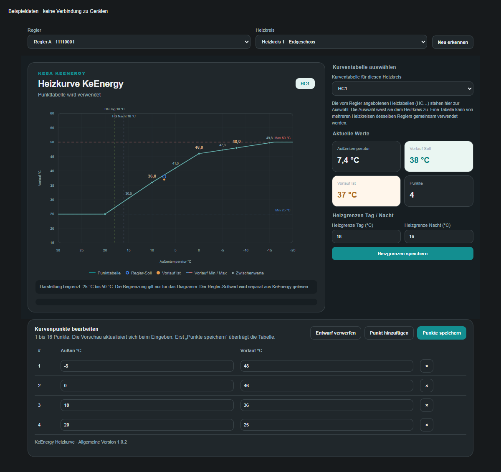

# KEBA KeEnergy Heating Curve Card

Eine Home-Assistant-Dashboard-Karte für die Heizkurven von KEBA-KeEnergy-Wärmepumpen.

[English version](README.md)



## Funktionen

- Zeigt die Heizkurve als Diagramm, mit aktueller Außen- und Vorlauftemperatur.
- Bearbeitet die Punkte der Kurventabelle (1 bis 16 Punkte).
- Bearbeitet die Heizgrenzen für Tag und Nacht.
- Wählt die Kurventabelle eines Heizkreises.
- Findet Regler und Heizkreise selbst.
- Optionale Kennwortsperre für die Karte.
- Deutsch und Englisch.

## Voraussetzungen

- Home Assistant 2026.11.0 oder neuer mit der Integration [KEBA KeEnergy](https://github.com/superbox-dev/keba_keenergy).
- Zum Speichern der Punkte: die Aktion `keba_keenergy.set_heating_curve_points` (Integration 1.12.2 oder neuer).

## Installation

### HACS

[][redirect-hacs]

1. Öffne **Einstellungen** → **Marketplace**.
2. Suche **KEBA KeEnergy Heating Curve Card** und wähle **Installieren**.
3. Lade den Browser neu.

[redirect-hacs]: https://my.home-assistant.io/redirect/hacs_repository/?owner=superbox-dev&repository=keba_keenergy_heating_curve_card&category=plugin

### Manuell

1. Lade `keba_keenergy_heating_curve_card.js` aus dem [neuesten Release][latest-release] herunter.
2. Kopiere die Datei nach `/config/www/`.
   - Hast du den Ordner `www` neu angelegt? Dann starte Home Assistant einmal neu.
3. Öffne **Einstellungen** → **Dashboards** → **Ressourcen**.
   - Das Menü ist oben rechts.
   - Es braucht den erweiterten Modus in deinem Benutzerprofil.
4. Füge die URL `/local/keba_keenergy_heating_curve_card.js` als **JavaScript-Modul** hinzu.
5. Lade den Browser neu.

Hänge nach einem Update `?v=<Version>` an die URL an. Dann lädt der Browser die neue Datei.

Mit YAML-Ressourcen ergänzt du deine `lovelace`-Konfiguration so:

```yaml
lovelace:
  resource_mode: yaml
  resources:
    - url: /local/keba_keenergy_heating_curve_card.js
      type: module
```

[latest-release]: https://github.com/superbox-dev/keba_keenergy_heating_curve_card/releases/latest

### Update von `keba-keenergy-heizkurve`

Karte und Datei heißen jetzt englisch. Passe bestehende Dashboards einmal an:

1. Installiere die neue Version.
   - HACS: lade sie in HACS herunter.
   - Manuell: kopiere die [neue Datei](https://github.com/superbox-dev/keba_keenergy_heating_curve_card/releases/latest/download/keba_keenergy_heating_curve_card.js) nach `/config/www/` und lösche
     `/config/www/keba-keenergy-heizkurve.js`.
2. Ersetze in den Dashboard-Ressourcen `/local/keba-keenergy-heizkurve.js` durch
   `/local/keba_keenergy_heating_curve_card.js`.
   - Mit HACS: prüfe, dass die Ressource auf `keba_keenergy_heating_curve_card.js` zeigt.
3. Ersetze in jeder Karte `type: custom:keba-keenergy-heizkurve-card` durch
   `type: custom:keba-keenergy-heating-curve-card`.
   - Alle anderen Optionen bleiben gleich.
4. Lade den Browser neu.

Bis dahin zeigt Home Assistant an der Stelle der Karte einen Fehler.

## Verwendung

Füge einem Dashboard eine Karte mit diesem Inhalt hinzu:

```yaml
type: custom:keba-keenergy-heating-curve-card
```

- Das reicht für einen Regler mit einem Heizkreis.
- [dashboard.yaml](dashboard.yaml) enthält ein fertiges Dashboard mit breiter Ansicht.
- Weitere Beispiele sind in [examples/](examples/).

### Regler und Heizkreise

- Die Karte findet alle Regler und Heizkreise der Integration.
- Umbenannte Entitäten findet sie auch.
- Bei mehreren zeigt die Karte Auswahlfelder.
- **Das Umschalten ändert nur die Ansicht. Es sendet nichts an die Wärmepumpe.**
- Zuerst erscheint der erste Regler und Heizkreis.
- Für eine feste Ansicht wählst du beide im visuellen Karteneditor.

### Kurventabellen

- Eine Kurventabelle ist eine Tabelle wie `HC1` oder `HC2`.
- Sie ist nicht die Nummer des Heizkreises.
- Die Auswahl einer Kurventabelle weist sie dem angezeigten Heizkreis zu. **Das wird sofort gesendet.**
- Mehrere Heizkreise können eine Kurventabelle teilen.
  - Speicherst du ihre Punkte, ändert sich die Kurve für alle.

### Punkte

- Bearbeite, ergänze und entferne 1 bis 16 Punkte.
- Das Diagramm ändert sich schon beim Tippen.
- **Erst „Punkte speichern“ sendet die Punkte an die Wärmepumpe.**
- Erlaubte Werte:
  - Außentemperatur: −40 bis 40 °C
  - Vorlauftemperatur: 10 bis 90 °C
  - Jede Außentemperatur nur einmal
- Mit ungespeicherten Änderungen kannst du Tabelle, Regler und Heizkreis nicht wechseln.
  - Speichere zuerst oder wähle **Entwurf verwerfen**.

### Heizgrenzen

- Bearbeite die Heizgrenzen für Tag und Nacht.
- **Heizgrenzen speichern** sendet die geänderten Werte.
- Die Felder nutzen die Grenzen und Schritte der Entitäten.

### Diagramm

- Zeigt die Punkte, die Heizgrenzen und die Außentemperatur.
- Zeigt die Soll- und Ist-Vorlauftemperatur.
- Zeigt alle 5 °C einen Zwischenwert, oder alle `intermediate_step`.
  - Er wird aus der Tabelle berechnet.
  - Der Regler kann trotzdem einen anderen Sollwert nutzen.
- `flow_min` und `flow_max` begrenzen nur das Diagramm.
  - Sie ändern weder die Punkte noch den Regler.

### Diagrammachsen

- Öffne **Diagrammachsen** im visuellen Karteneditor.
- Stelle Minimum, Maximum und Rasterweite in °C für Außentemperatur (X) und Vorlauftemperatur (Y) ein.
  - Leere Grenzen sind automatisch, die Rasterweite ist standardmäßig 5 °C.
- **Zwischenwerte** stellt den Abstand der Zwischenwerte ein, unabhängig vom Raster.
- Die Achsen ändern nur das Diagramm, nicht die Punkte oder den Regler.

```yaml
type: custom:keba-keenergy-heating-curve-card
x_min: -15
x_max: 25
x_step: 5
y_min: 20
y_max: 45
y_step: 2.5
intermediate_step: 2.5
```

### Einheiten

- Die Karte zeigt alle Temperaturen in °C.
- Entitäten in °F oder K rechnet sie um.
- Heizgrenzen speichert sie in der Einheit ihrer Entität.

### Deaktivierte Entitäten

Die Integration deaktiviert manche Entitäten. Die Karte braucht die [Entitäten](#entitäten) aus der Tabelle unten.

So aktivierst du sie:

- Als Administrator: wähle in der Karte **Bearbeitungs-Entitäten aktivieren**.
- Oder aktiviere sie in den Entitätseinstellungen der Integration.

Fehlende Messwerte zeigt die Karte als `—`.

### Ohne Administratorrechte

- Die Karte kann das Entitätenverzeichnis dann eventuell nicht lesen.
- Trage `config_entry` und `entities` dann von Hand ein.
- Siehe [examples/manual-entities.yaml](examples/manual-entities.yaml).
- Alle Entitäten müssen zum selben Regler und Heizkreis gehören.
- **Neu erkennen** liest das Verzeichnis erneut.

### Sprache

- Standard: die Sprache deines Home-Assistant-Profils.
- Deutsche Profile nutzen Deutsch, alle anderen Englisch.
- Eine feste Sprache stellst du im visuellen Editor ein oder mit `language: de` bzw. `language: en`.
- Eigene Titel, Namen und Tabellennamen bleiben unverändert.

### Kennwort

- Standardmäßig ist kein Kennwort gesetzt.
- So richtest du eines ein:
  1. Öffne den visuellen Karteneditor.
  2. Öffne **Kennwortschutz**.
  3. Gib das Kennwort zweimal ein und wähle **Kennwort einrichten**.
  4. Speichere die Karte.
- Die Karte speichert nur einen Prüfwert (PBKDF2-SHA256), nie das Kennwort.
- Die Karte sperrt sich wieder:
  - nach `auto_lock_minutes` ohne Bearbeitung (Standard 5)
  - wenn du den Browser-Tab verlässt
  - wenn du die Karte schließt
  - wenn du Regler oder Heizkreis wechselst
- Das Sperren verwirft ungespeicherte Änderungen.

> [!WARNING]
> Das Kennwort sperrt nur diese Karte. Es ersetzt keine Home-Assistant-Berechtigungen.
> Wer das Dashboard bearbeiten darf, kann es entfernen.

## Konfiguration

| Option | Standard | Bedeutung |
| --- | --- | --- |
| `title` | Heizkurve KeEnergy | Titel der Karte |
| `language` | `auto` | `auto`, `de` oder `en` |
| `config_entry` | automatisch | Fester Regler, über die ID seines Integrationseintrags |
| `serial` | automatisch | Fester Regler, über seine Seriennummer |
| `circuit` | automatisch | Fester Heizkreis, ab `1` |
| `flow_min`, `flow_max` | keine | Diagrammgrenzen in °C, 10 bis 90 |
| `x_min`, `x_max` | automatisch | Sichtbarer Außentemperaturbereich in °C, −100 bis 100 |
| `y_min`, `y_max` | automatisch | Sichtbarer Vorlauftemperaturbereich in °C, 0 bis 150 |
| `x_step`, `y_step` | 5 | Rasterweite in °C, 0,01 bis 200 (X) bzw. 150 (Y) |
| `intermediate_step` | 5 | Abstand der Zwischenwerte in °C |
| `edit_password_hash` | keiner | Setzt der visuelle Editor |
| `auto_lock_minutes` | 5 | Minuten bis zur erneuten Sperre, 1 bis 60 |
| `entities` | automatisch | Manuelle Entitäten, siehe [examples/manual-entities.yaml](examples/manual-entities.yaml) |

- Lass `config_entry`, `serial`, `circuit` und `entities` weg, um sie in der Karte zu wählen.
- [examples/fixed-heating-circuit.yaml](examples/fixed-heating-circuit.yaml) zeigt einen festen Heizkreis.

### Entitäten

Die Karte findet diese Entitäten selbst. Trage sie nur in `entities` ein, wenn das nicht klappt.

| Schlüssel | Domäne | Entität |
| --- | --- | --- |
| `curve_select` | `select` | Kurventabelle des Heizkreises |
| `curve_sensor` | `sensor` | Heizkurve mit dem Attribut `points` |
| `outdoor_temperature` | `sensor` | Außentemperatur |
| `flow_temperature` | `sensor` | Ist-Vorlauftemperatur |
| `flow_setpoint` | `sensor` | Soll-Vorlauftemperatur |
| `use_heating_curve` | `switch` | Status der Punkttabelle (optional) |
| `heating_limit_day` | `number` | Heizgrenze Tag |
| `heating_limit_night` | `number` | Heizgrenze Nacht |

- Alle Entitäten müssen zum selben Regler und Heizkreis gehören.
- Siehe [examples/manual-entities.yaml](examples/manual-entities.yaml).

## Gut zu wissen

- Die Karte ändert nie die Kurvenart (Punkttabelle oder Hybrid).
- Die Karte ändert nie Steigung oder Offset.
- Die Karte lädt nichts aus dem Internet.
- MQTT oder Node-RED sind nicht nötig.

## Changelog

Der [Changelog](CHANGELOG.md) listet die Änderungen jedes Releases.

## Mitmachen

[][workflow-ci]

- Fehler gefunden oder eine Idee? [Erstelle ein Issue](https://github.com/superbox-dev/keba_keenergy_heating_curve_card/issues/new/choose).
- Du willst am Code mithelfen? Lies die [Anleitung für Beiträge](CONTRIBUTING.md) (auf Englisch).

[workflow-ci]: https://github.com/superbox-dev/keba_keenergy_heating_curve_card/actions/workflows/ci.yml

## Lizenz

- [MIT](LICENSE)
- Die eingebundene Bibliothek [@noble/hashes](https://github.com/paulmillr/noble-hashes): siehe [THIRD_PARTY_NOTICES.md](THIRD_PARTY_NOTICES.md)
