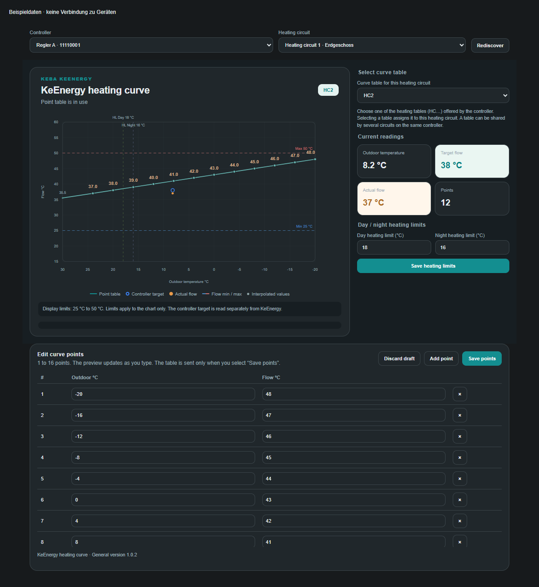

# KEBA KeEnergy Heating Curve Card 1.1.0

A reusable, unofficial Home Assistant custom card for
[superbox-dev/keba_keenergy](https://github.com/superbox-dev/keba_keenergy).
The card and its visual editor support **German and English**. There are no hardcoded personal entities,
serial numbers, addresses or passwords. See `README.md` for full documentation.



1. Copy `keba_keenergy_heating_curve_card.js` to `/config/www/`. If you create `www` for the
   first time, restart Home Assistant once.
2. Add `/local/keba_keenergy_heating_curve_card.js?v=1.1.0` as a **JavaScript module** dashboard
   resource and reload the frontend.
3. Add the card from `card.yaml`, or use `dashboard.yaml` for a dedicated dashboard.

```yaml
type: custom:keba-keenergy-heating-curve-card
language: auto
```

## Update an existing card

The card and its file now have English names. Adapt existing dashboards once:

1. Install the new version: in HACS, open **KEBA KeEnergy Heating Curve Card** and download it. For a manual
   installation, copy the [release file](https://github.com/superbox-dev/keba_keenergy_heating_curve_card/releases/latest/download/keba_keenergy_heating_curve_card.js) to `/config/www/` and delete
   `/config/www/keba-keenergy-heizkurve.js`.
2. In the dashboard resources, replace `/local/keba-keenergy-heizkurve.js` with
   `/local/keba_keenergy_heating_curve_card.js?v=1.1.0`. With HACS, check that the resource points to
   `keba_keenergy_heating_curve_card.js`.
3. In every card, replace `type: custom:keba-keenergy-heizkurve-card` with
   `type: custom:keba-keenergy-heating-curve-card`. All other options stay the same.
4. Reload the dashboard in the browser.

Until then, Home Assistant shows an error in place of the card.

Controllers and heating circuits are discovered using the KeEnergy entity registry
unique IDs, including renamed entity IDs. Switching controller/circuit only changes
the view. The first discovered controller/circuit is the initial view; pin a controller
and circuit in the visual editor for a fixed starting view. Selecting a curve table
assigns it to the heating circuit and writes immediately. Tables named HC1/HC2 are
distinct from circuit numbers. Editing a shared table affects every circuit using
that table on the same controller. Points and heating limits have explicit save buttons.

Language defaults to the current user's HA profile (`language: auto`). German
regional variants use German; other languages fall back to English. Set `language: de`
or `language: en` to override it, or select **Language** in the visual editor.
Numbers respect HA number-format preferences. Custom titles, device/room names,
entity IDs and table names remain unchanged; omit `title` for the localized default.
Backend error details are passed through as received.

Under **Chart axes** in the visual editor, set the bounds and grid interval in °C
independently for the outdoor temperature (X) and flow temperature (Y). The YAML
options are `x_min`, `x_max`, `x_step`, `y_min`, `y_max` and `y_step`. Empty
bounds are automatic and the default grid interval is 5 °C. The axis settings
affect only the visible chart. The `flow_min` and `flow_max` options still limit
the plotted curve.

Under **Interpolated values** in the same section, set the interval along the outdoor
temperature axis independently of the grid. In YAML, use `intermediate_step: 2.5`
for points every 2.5 °C. The default is 5 °C. Short intervals show fewer labels,
and very dense points are drawn at whole multiples of the requested interval.

The visual editor can also configure a controller/circuit and an individual
password. Password protection is off
by default. An optional salted PBKDF2-SHA256 verifier is saved in the card configuration;
the frontend edit lock does not replace HA authorization or protect other cards/actions.

An administrator can enable the required disabled entities from the card. Missing
hardware capabilities cannot be added by this card. For manual mappings see
`examples/manual-entities.yaml`; substitute every placeholder with your own IDs.

Checked against integration source 1.12.2 on 2026-11-23. Requires a heating-curve sensor
with a `points` attribute and, for saving points, the
`keba_keenergy.set_heating_curve_points` action. Older versions without the action
cannot save points. Tested in a local browser with simulated HA, including multiple
controllers/circuits and frequent updates; not tested on physical hardware.

Single self-contained runtime file, no external runtime downloads. Source and build
files included. Node.js 20.19+: `npm install`, `npm test`, `npm run build`.
MIT licensed; see `THIRD_PARTY_NOTICES.md` for the bundled cryptography library license.
