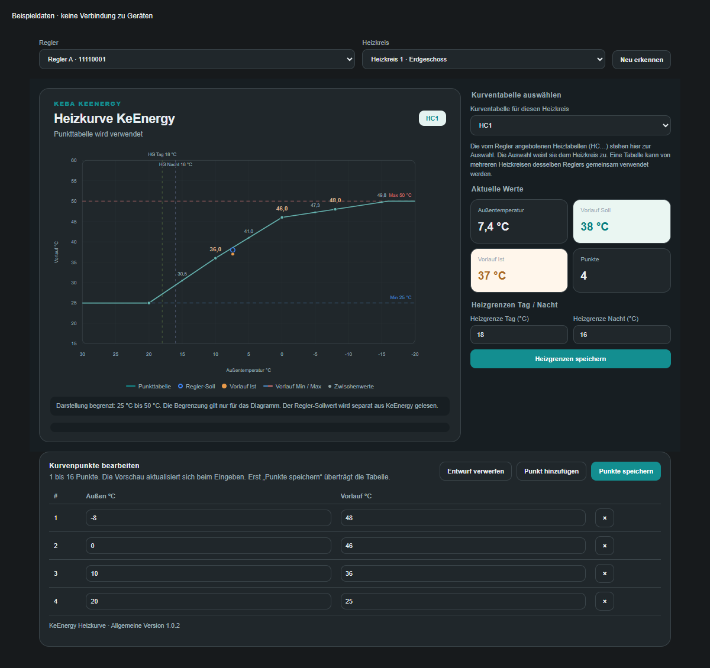

# KEBA KeEnergy Heating Curve Card

Allgemeine, eigenständige Home-Assistant-Custom-Card für die Integration
[superbox-dev/keba_keenergy](https://github.com/superbox-dev/keba_keenergy).
Version **1.1.0**. Keine fest eingetragene Seriennummer, keine fremden Entitäten,
kein voreingestelltes Kennwort. Die bisherige persönliche M-TEC-Karte kann daneben bestehen bleiben.



## Installation

1. `keba_keenergy_heating_curve_card.js` nach `/config/www/` kopieren. Den Ordner `www`
   bei Bedarf anlegen; nach erstmaligem Anlegen Home Assistant einmal neu starten.
   Die Datei ist vollständig; zusätzliche Frontend-Bibliotheken
   oder andere Custom Cards sind nicht nötig.

2. Im Dashboard unter **Einstellungen → Dashboards → Ressourcen** hinzufügen:
   URL `/local/keba_keenergy_heating_curve_card.js?v=1.1.0`, Typ **JavaScript-Modul**.
   Die Ressourcenverwaltung ist gegebenenfalls im Drei-Punkte-Menü und bei
   aktiviertem erweiterten Benutzermodus sichtbar. Bei YAML-Ressourcenverwaltung:

   ```yaml
   lovelace:
     resource_mode: yaml
     resources:
       - url: /local/keba_keenergy_heating_curve_card.js?v=1.1.0
         type: module
   ```

   In eine vorhandene `lovelace`-Konfiguration einfügen, keinen zweiten gleichnamigen
   Hauptschlüssel anlegen.
   Die aktuelle Einrichtung beschreibt auch die
   [Home-Assistant-Dokumentation zu Ressourcen](https://contributors.home-assistant.io/frontend/custom-ui/resources/).

3. Home-Assistant-Oberfläche vollständig neu laden. Im gewünschten Dashboard
   eine manuelle Karte mit dem Inhalt von `card.yaml` anlegen:

   ```yaml
   type: custom:keba-keenergy-heating-curve-card
   ```

Alternativ enthält `dashboard.yaml` ein vollständiges Dashboard mit einer breiten
Panel-Ansicht. Es ist für ein eigenes/neues Dashboard gedacht; im bestehenden
Dashboard nur die gewünschte Karte oder Ansicht ergänzen.

## Bestehende Karte aktualisieren

Karte und Datei heißen jetzt englisch. Bestehende Dashboards einmal anpassen:

1. Neue Version installieren:
   - **Über HACS installiert.** Die **KEBA KeEnergy Heating Curve Card** in HACS öffnen und die neue Version
     herunterladen.
   - **Manuell installiert.** Die [JavaScript-Datei aus dem Release](https://github.com/superbox-dev/keba_keenergy_heating_curve_card/releases/latest/download/keba_keenergy_heating_curve_card.js) nach `/config/www/` kopieren und die
     alte Datei `/config/www/keba-keenergy-heizkurve.js` löschen.

2. In den Dashboard-Ressourcen die URL `/local/keba-keenergy-heizkurve.js` durch
   `/local/keba_keenergy_heating_curve_card.js?v=1.1.0` ersetzen. Bei HACS prüfen, dass die Ressource auf
   `keba_keenergy_heating_curve_card.js` zeigt.
3. In jeder Karte `type: custom:keba-keenergy-heizkurve-card` durch
   `type: custom:keba-keenergy-heating-curve-card` ersetzen. Alle anderen Optionen bleiben gleich.
4. Dashboard im Browser neu laden.

Bis zur Anpassung zeigt Home Assistant an der Stelle der Karte einen Fehler.

## Regler, Heizkreis und Kurventabelle

Die Karte liest das Entitätenverzeichnis von Home Assistant einmal beim Einrichten.
Sie ordnet die `unique_id` und den Integrationseintrag aus `keba_keenergy` zu.
Umbenannte Entity-IDs werden dadurch ebenfalls gefunden. Bei einem Regler mit
einem Heizkreis ist keine weitere Zuordnung erforderlich.

Bei mehreren Reglern oder Heizkreisen erscheinen Auswahlfelder in der Karte.
**Regler/Heizkreis wechseln nur die Ansicht und senden keine Befehle.** Der erste
erkannte Regler/Heizkreis ist die Startansicht. Die Auswahl gilt für die aktuelle
Karteninstanz; für eine feste Startansicht die Zuordnung im visuellen Karteneditor
speichern. Eine weitere Karte kann einen anderen Heizkreis fest anzeigen.

Die **Kurventabelle** ist eine eigene Auswahl, z. B. HC1 oder HC2. Sie ist nicht die
Nummer des Heizkreises. Die Auswahl einer Kurventabelle weist diese dem angezeigten
Heizkreis zu und wird unmittelbar übertragen. Angezeigt werden die vom Regler
angebotenen Heiztabellen mit dem Präfix `HC`.

Eine Kurventabelle kann von mehreren Heizkreisen desselben Reglers gemeinsam
verwendet werden. Werden ihre Punkte gespeichert, wirkt sich das auf alle diese
Heizkreise aus. Bei ungespeicherten Änderungen blockiert die Karte einen Tabellen-,
Regler- oder Heizkreiswechsel; zuerst speichern oder **Entwurf verwerfen** wählen.

## Punkte, Heizgrenzen und Anzeige

- **Punkte:** 1 bis 16 Stützpunkte bearbeiten, hinzufügen und entfernen.
  Die Vorschau aktualisiert sich beim Eingeben. Erst **Punkte speichern** ruft
  `keba_keenergy.set_heating_curve_points` auf, mit dem passenden Integrationseintrag
  und Tabellennamen. Zulässig: außen −40 bis +40 °C, Vorlauf 10 bis 90 °C;
  Außentemperaturen müssen auch nach Rundung auf zwei Nachkommastellen eindeutig sein.
- **Heizgrenzen Tag/Nacht:** Die Felder verwenden die Grenzen und Schrittweiten der
  jeweiligen `number`-Entitäten. **Heizgrenzen speichern** überträgt geänderte Werte.
  Die Karte stellt Temperaturen in °C dar; HA-Entitäten mit °F/K werden für die
  Anzeige umgerechnet, und Heizgrenzen in der Einheit ihrer Entität zurückgeschrieben.
- **Diagramm:** Stützpunkte, kleinere Zwischenwerte mit einstellbarem Abstand, Heizgrenzen,
  Außentemperatur sowie separat gelesene Vorlauf-Soll- und Isttemperatur.
  Zwischenwerte sind eine lineare Berechnung aus der Tabelle. Zusätzliche Einflüsse
  des Reglers können den tatsächlichen Sollwert verändern.
- **Vorlauf Min/Max im Diagramm:** Optional im visuellen Editor oder per `flow_min`
  und `flow_max`. Ohne Angabe wird keine persönliche Begrenzung angenommen.
  Diese Optionen begrenzen ausschließlich die Zeichnung, verändern weder die
  gespeicherten Punkte noch die Vorlaufbegrenzungen im Regler.
- **Aktualisierung:** Messwerte werden aktualisiert, ohne bei jedem Sensorupdate
  Eingabefelder, offene Auswahllisten und den Scrollbereich neu anzulegen.
  Ab Version 1.0.1 bleiben beim Hinzufügen und Entfernen von Punkten auch die
  umgebende Karte und die Seitenposition erhalten.

Die Karte schaltet weder auf Hybrid um noch verändert sie Steigung/Offset.
Der vorhandene Zustand des Punkttabellen-Schalters wird nur angezeigt.

## Diagrammachsen einstellen

Öffne im Dashboard **Karte bearbeiten → Diagrammachsen**. Stelle für **X**
(Außentemperatur) und **Y** (Vorlauftemperatur) unabhängig Minimum, Maximum und
Rasterweite ein. Leere Grenzen werden automatisch ermittelt. Für eine leere
Rasterweite gilt 5 °C. Alle Werte sind in °C und können bis zu zwei
Nachkommastellen haben. Eine feste Untergrenze dient als Start des Rasters. Bei
engem Raster werden weniger Zahlen angezeigt. Bei sehr vielen Linien wird das
Raster in ganzzahligen Vielfachen der eingestellten Rasterweite gezeichnet.

Unter **Zwischenwerte** stellst du den Abstand entlang der Außentemperatur ein,
zum Beispiel 2,5 °C. Das Feld ist unabhängig vom Achsenraster. Leer gilt wie bisher
5 °C. Bei kleinen Abständen werden weniger Beschriftungen angezeigt. Bei sehr
kleinen Abständen erscheinen die Zwischenpunkte in ganzzahligen Vielfachen des
gewählten Abstands.

Die Achsenoptionen wählen den sichtbaren Ausschnitt. Kurvenpunkte, Heizgrenzen
und Reglerwerte bleiben gespeichert wie zuvor. `flow_min` und `flow_max`
begrenzen weiterhin die gezeichnete Kurve.

Dieselben Felder können zur vorhandenen Karten-YAML ergänzt werden:

```yaml
type: custom:keba-keenergy-heating-curve-card
x_min: -15
x_max: 25
x_step: 5
y_min: 20
y_max: 45
y_step: 2.5
intermediate_step: 2.5
```

## Benötigte Entitäten aktivieren

Die Integration deaktiviert manche Konfigurations- und Messentitäten standardmäßig.
Die Karte zeigt gefundene, aber deaktivierte Entitäten an. Als HA-Administrator
kann man sie mit **Bearbeitungs-Entitäten aktivieren** aktivieren. Es werden nur
die von dieser Karte verwendeten Entitäten des gewählten Reglers/Heizkreises
berücksichtigt; Thermostat- und andere Heizkreis-Einstellungen gehören nicht dazu.

Alternativ in den Entitätseinstellungen der Integration manuell aktivieren:
Kurvenauswahl (`select`), Heizkurven-Sensor mit Attribut `points`, Heizgrenze Tag/Nacht
(`number`), Außentemperatur, Vorlauf Soll/Ist und optional Punkttabellen-Status.
Fehlende Messwerte erscheinen als „—“; verfügbare Funktionen bleiben nutzbar.
Nicht vom Gerät unterstützte Entitäten kann die Karte nicht erzeugen.

Bei eingeschränkten Rechten kann das Lesen des Verzeichnisses fehlschlagen. Dann
als Administrator einrichten oder `config_entry` und `entities` manuell zuordnen,
siehe `examples/manual-entities.yaml`. Steuerungs-Entitäten müssen aus demselben
KeEnergy-Regler und Heizkreis stammen. Eine widersprüchliche oder mehrdeutige
Zuordnung blockiert Schreibaktionen. Ein verschwundener ausgewählter Regler wird
nicht automatisch durch einen anderen ersetzt. **Neu erkennen** liest das
Verzeichnis erneut, etwa nach Integrations- oder Entitätsänderungen.

## Sprache

Ab Version 1.0.2 sind Karte und visueller Karteneditor auf **Deutsch und Englisch**
verfügbar, einschließlich Kennwortdialog, eigener Status-/Fehlermeldungen und
Beschriftungen im Diagramm. Standard ist `language: auto`: Die Sprache wird aus dem
Home-Assistant-Profil des jeweiligen Benutzers übernommen. Deutsch einschließlich
regionaler Varianten wie `de-CH` verwendet Deutsch; Englisch und andere HA-Sprachen
verwenden Englisch als Ersatz. Es werden keine weiteren Sprachpakete heruntergeladen.

Im visuellen Karteneditor unter **Sprache** zwischen Automatisch, Deutsch und
Englisch wählen. Alternativ in YAML:

```yaml
type: custom:keba-keenergy-heating-curve-card
language: auto
```

Mit `language: de` oder `language: en` die Sprache für diese Karte fest vorgeben.
Zahlen folgen der HA-Zahlenformat-Einstellung beziehungsweise der gewählten Sprache.
Eigene Titel, Geräte-/Raumnamen, Entity-IDs und Tabellennamen wie HC1 bleiben
unverändert. Ohne `title` verwendet die Karte eine übersetzte Standardüberschrift.
Von HA oder dem Gerät gelieferte Fehlertexte werden unverändert weitergereicht.
Die API-Befehle, Einheitenumrechnung und gespeicherten Kurvenpunkte sind sprachunabhängig.

## Eigenes Kennwort

Standardmäßig ist kein Kennwort gesetzt. Im **visuellen Karteneditor → Kennwortschutz**
das eigene Kennwort zweimal eingeben, **Kennwort einrichten** wählen und anschließend
die Kartenkonfiguration speichern. Es wird ein zufällig gesalzener
PBKDF2-SHA256-Prüfwert mit 120.000 Durchläufen unter `edit_password_hash` abgelegt,
kein Klartextkennwort. Jede Installation kann ihr eigenes Kennwort nutzen.

Die Karte ist danach beim Öffnen gesperrt. Entsperren ist per Schaltfläche oder Enter
möglich. Automatische Sperre nach `auto_lock_minutes` ohne Bearbeitung (Standard 5,
zulässig 1 bis 60), beim Verlassen des Tabs, beim Schließen der Karte oder beim
Wechsel von Regler/Heizkreis. Sperren verwirft ungespeicherte Änderungen.
Das Kennwort und die Freigabe werden nicht im Browser-Speicher abgelegt.

**Der Kennwortschutz ist eine Bediensperre dieser Karte.** Er ersetzt keine
Home-Assistant-Berechtigungen. Wer die Dashboard-Konfiguration bearbeiten kann,
kann den Prüfwert entfernen; andere HA-Karten und direkte Aktionen werden dadurch
nicht gesperrt. Ein früher in einer anderen persönlichen Karte eingerichtetes
Kennwort wird nicht automatisch übernommen.

## Optionen

| Option | Standard | Bedeutung |
| --- | --- | --- |
| `title` | Heizkurve KeEnergy | Überschrift |
| `language` | auto | HA-Profilsprache; alternativ `de` oder `en` |
| `config_entry` | automatisch | Regler über ID des Integrationseintrags fest zuordnen |
| `serial` | automatisch | Alternativ Regler über Seriennummer fest zuordnen |
| `circuit` | automatisch | Heizkreisnummer ab `1`; auch ein einzelner Heizkreis ist `1` |
| `x_min`, `x_max` | automatisch | Sichtbarer Außentemperaturbereich, −100 bis 100 °C |
| `y_min`, `y_max` | automatisch | Sichtbarer Vorlauftemperaturbereich, 0 bis 150 °C |
| `x_step`, `y_step` | 5 | Rasterweite in °C, ab 0,01 bis 200 (X) bzw. 150 (Y) |
| `flow_min`, `flow_max` | keine | Optionale Diagrammgrenzen in °C, zwischen 10 und 90 |
| `edit_password_hash` | kein Schutz | Individueller PBKDF2-Prüfwert aus dem visuellen Editor |
| `auto_lock_minutes` | 5 | Inaktivitätsfrist bei eingerichtetem Kennwort |
| `entities` | automatisch | Manuelle Zuordnung mit den Schlüsseln der Beispieldatei |

Für automatisch auswählbare Regler/Heizkreise `config_entry`, `serial`, `circuit`
und `entities` weglassen. Feste Zuordnungen und manuelle Entitäten müssen zusammenpassen.

## Kompatibilität und Prüfung

Abgeglichen mit dem öffentlichen Quellcode von `superbox-dev/keba_keenergy`
Version **1.12.2**, abgerufen am **23.11.2026**. Benötigt einen Heizkurven-Sensor
mit `points`, für Punkteänderungen außerdem die Aktion
`keba_keenergy.set_heating_curve_points`. Ältere Integrationen ohne diese Aktion
können die Punkte nicht über diese Karte speichern. Kein MQTT oder Node-RED nötig.
Andere, nur ähnlich benannte Integrationen sind nicht automatisch kompatibel.

Lokal in Edge mit simuliertem HA getestet: mehrere Regler/Heizkreise, umbenannte
Entitäten, getrennte Schreibziele, deaktivierte Entitäten, fehlende Dienste,
eingeschränkte Rechte, widersprüchliche Zuordnungen, verschwundener Regler,
Kennwort-Erstellung/Entsperren, Dropdowns und Scrollen bei 25 Updates pro Sekunde,
helle/dunkle Darstellung und Mobilansicht. Keine Hardwareprüfung und keine Befehle
an echte Anlagen im Rahmen dieser Tests.

## Weitergeben und Quellcode

Das Paket kann vollständig weitergegeben werden. `assets/` enthält ausschließlich
Beispieldaten. Die Karte lädt zur Laufzeit keine externen Skripte. Sie enthält weder
persönliche Zugangsdaten noch feste Netzadressen oder Seriennummern.

Quellcode in `src/`, portable Erkennungstests in `tests/`. Für Änderungen Node.js 20.19+
verwenden, im Paketordner `npm install`, `npm test` und `npm run build` ausführen.
Die neue Bundle-Datei liegt anschließend wieder im Paketordner. Zur Nutzung in HA
ist dieser Build-Schritt nicht erforderlich. MIT-Lizenz, Hinweise zu eingebundenem
`@noble/hashes` in `THIRD_PARTY_NOTICES.md`. Inoffizielle Karte; kein KEBA-Produkt.
